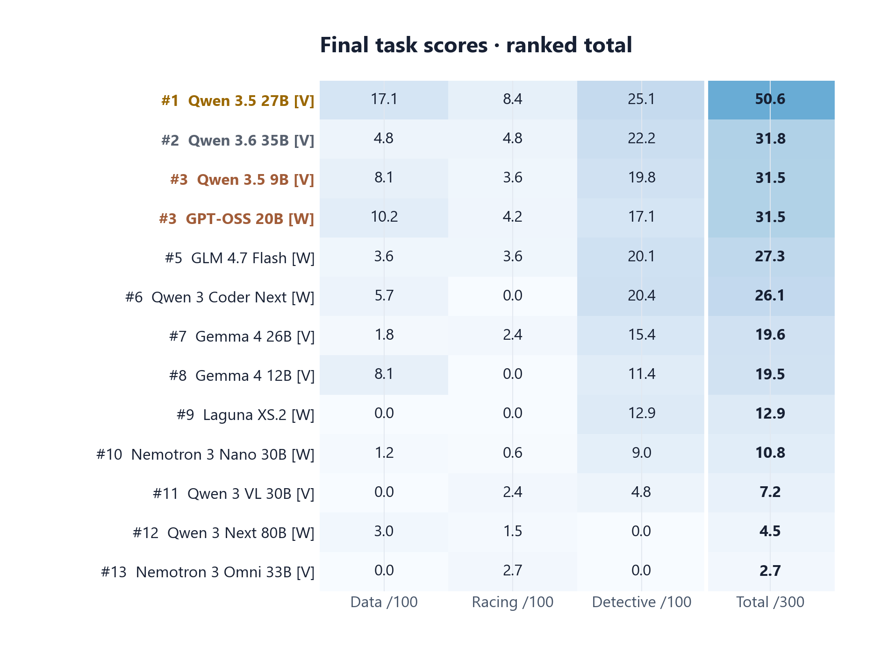
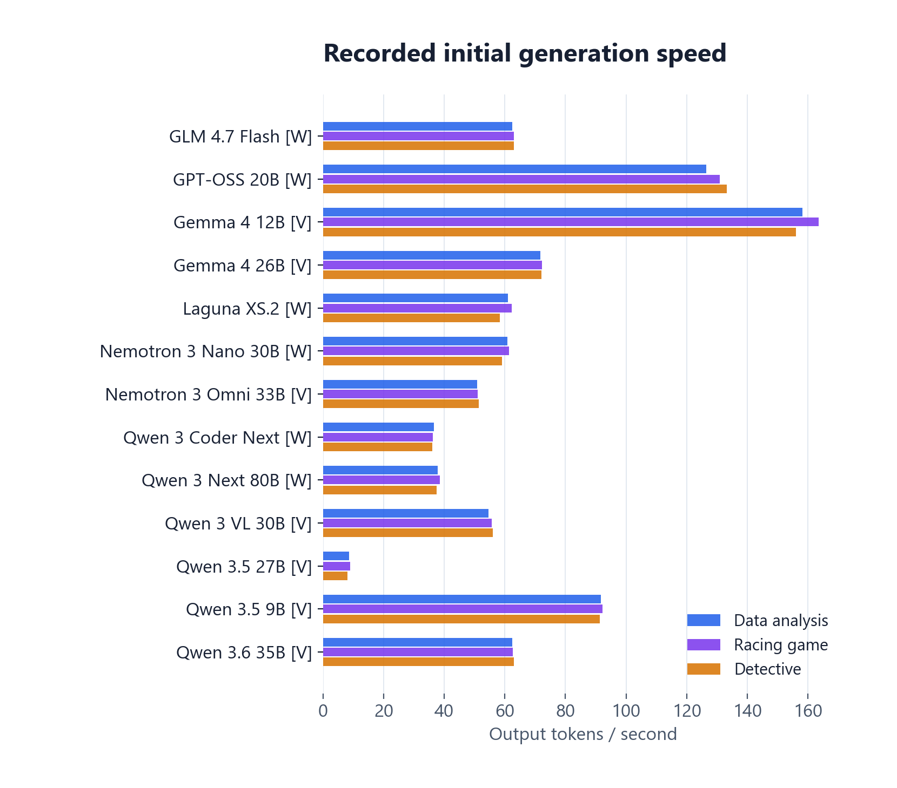
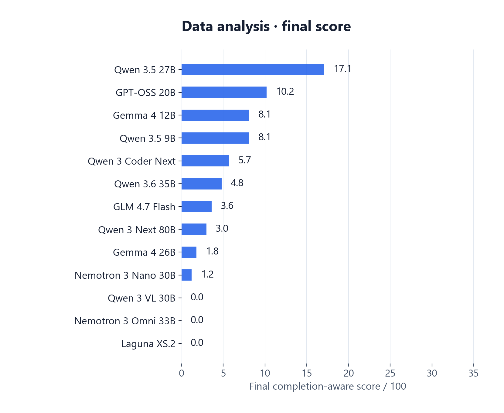
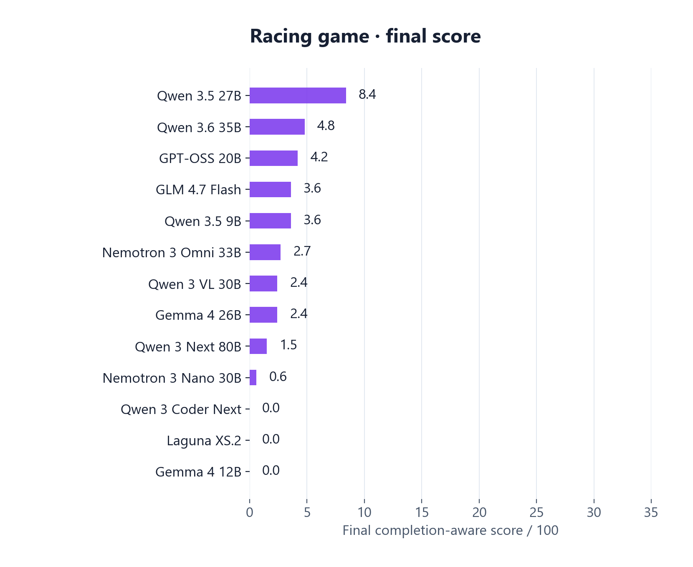
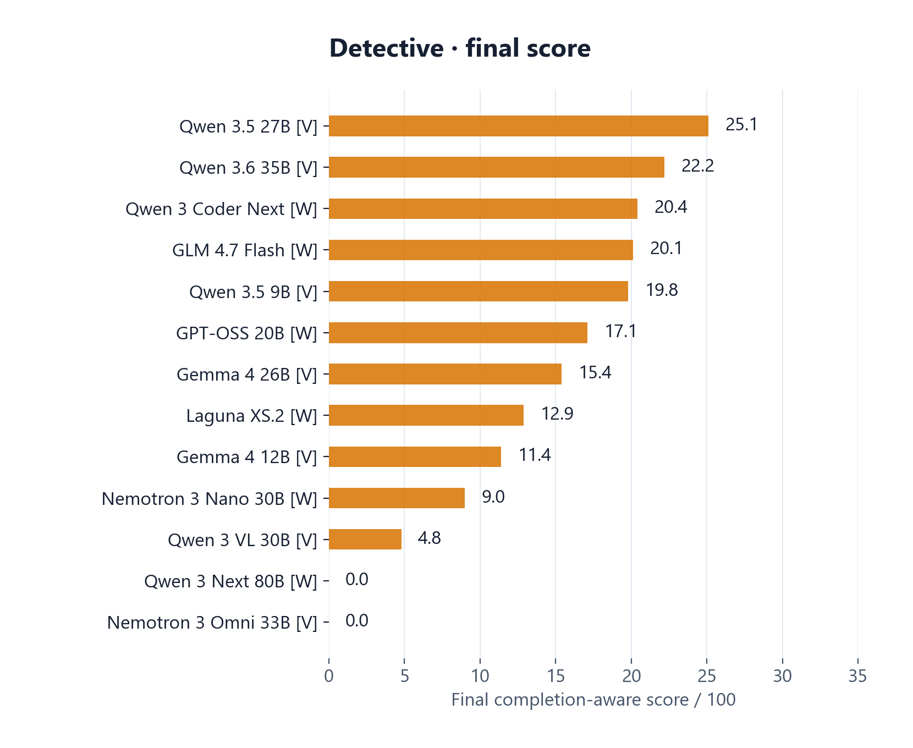
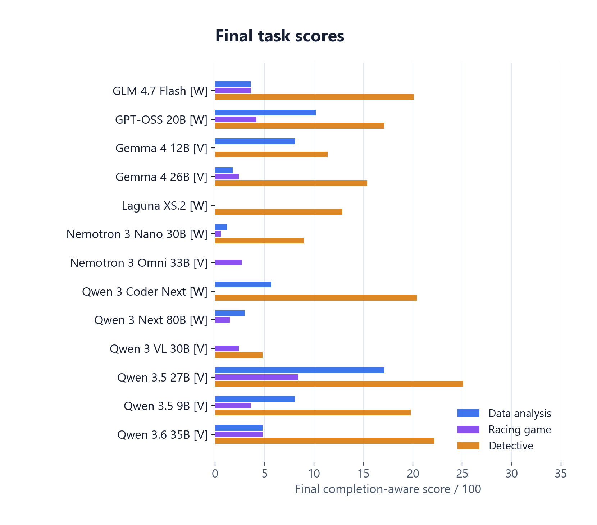
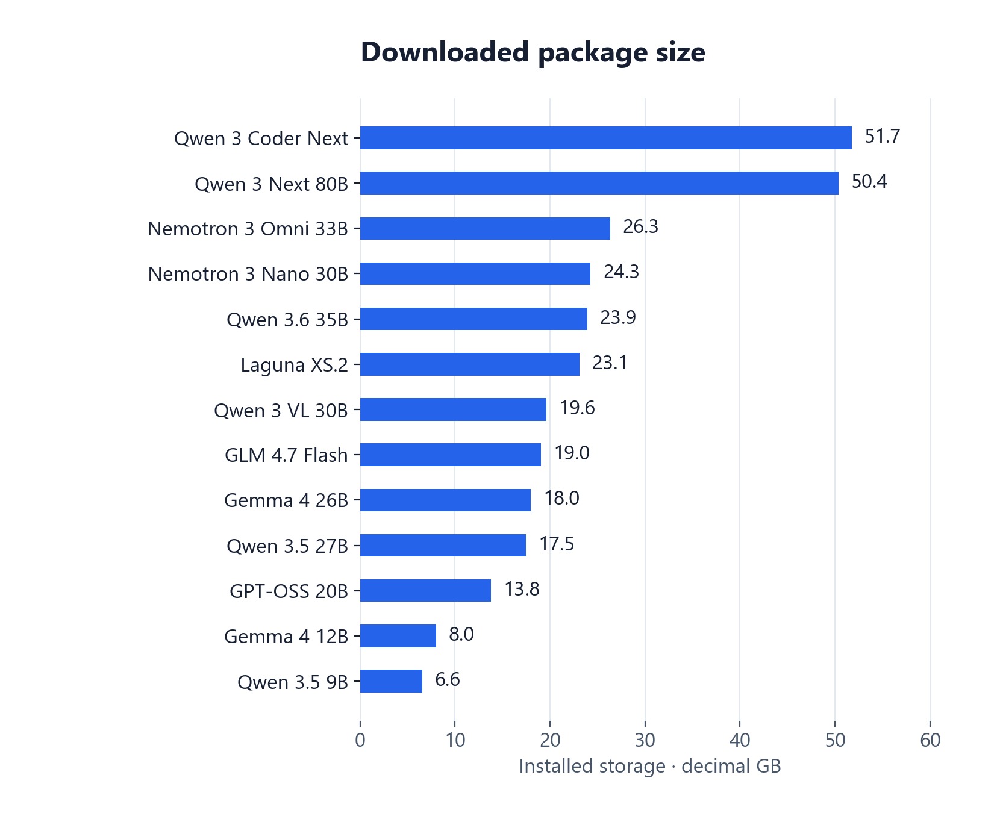
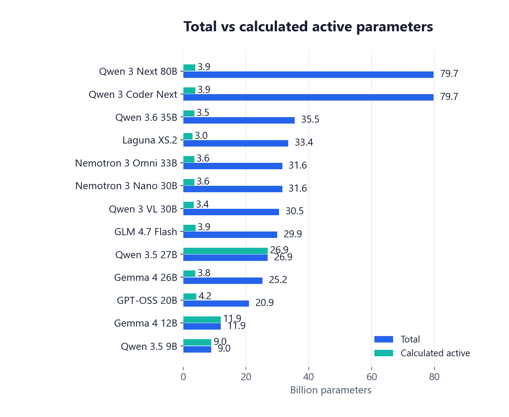
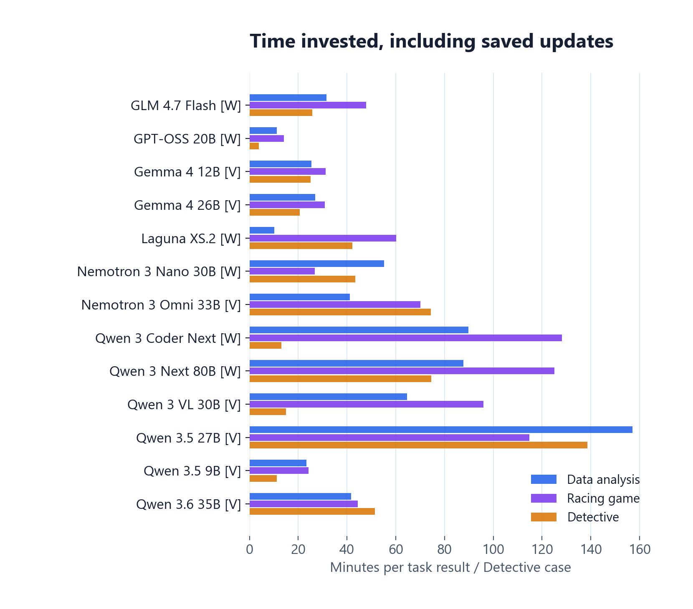
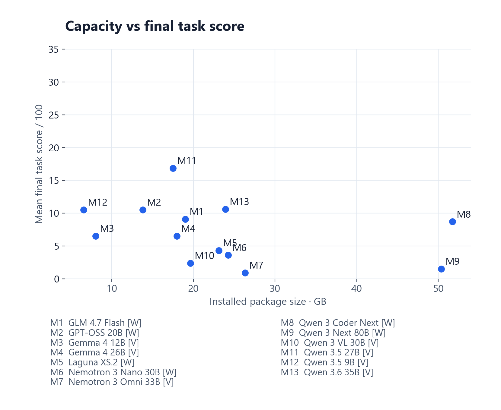

# Local AI Benchmark

**What can local AI models actually finish on a powerful desktop?** Explore 13 locally benchmarked models across data analysis, a 3D racing game and evidence-based detective investigations. Compare their saved outputs, output-only rubric judgments, token speed and memory-related model sizes in an interactive dashboard.

[**Explore the dashboard →**](https://maninka123.github.io/local-ai-benchmark/) · [Results guide](docs/publication/RESULTS.md) · [Methodology](docs/publication/METHODOLOGY.md) · [Run on your PC](docs/publication/RUN_ON_YOUR_PC.md)

| Models | Task families | Saved task results | Output reviews | Desktop |
| :-- | :-- | :-- | :-- | :-- |
| **13** | **3** | **53** | **159**, across three prompts | **RTX 4080 16 GB · i9-13900K · 64 GB RAM** |

Includes the software, prompts, scores and saved outputs. **Model weights are excluded.** Browse reports and game builds in the dashboard, or follow the [rerun guide](docs/publication/RUN_ON_YOUR_PC.md) to test models on your own PC.

## Read the results correctly

- **Completion:** 1/53 results fully complete: Qwen 3.5 27B, Detective case 3, on prompt 3.
- **One final score:** completion on prompts 1 / 2 / 3 earns **100 / 60 / 30**. An unfinished third attempt earns **0–30 partial credit**; earlier failures are unscored.
- **AI review:** time and assisted repairs are excluded. Compare Detective results within the labelled visual or written track. [Full scoring method](docs/publication/METHODOLOGY.md).

## Results at a glance

Compare task scores and speed below. Explore exact values in the [interactive dashboard](https://maninka123.github.io/local-ai-benchmark/).

### Final scores by task

**Total = Data + Racing + Detective case mean, out of 300.** Ranks follow that sum; ties share a rank. **[V] visual / [W] written** inputs differ, so this is a descriptive comparison.

### Recorded generation speed

Initial output tokens/s on the tested desktop. Speed is separate from task quality.

<strong>Task-by-task scores · four more figures</strong>

### Data analysis

### Racing game

### Detective investigations

### Completion-aware score comparison

<strong>Storage, active parameters, time and capacity · four more figures</strong>

### Installed model storage

### Total and calculated active parameters

Structural estimates, not measured routing or memory use. Unavailable values are omitted.

### Total time invested

Initial work + saved updates + evaluations; Detective shown per case.

### Capacity and final task score

One-PC pilot; model quantization and Detective input tracks differ. [Definitions and limits](docs/publication/METHODOLOGY.md).

## Three challenges, actual outputs

| Challenge | What the model must deliver | What you can inspect |
| :-- | :-- | :-- |
| **Data analysis** | Investigate six related tables, identify unexpected patterns, produce executable analysis, findings, charts and a written report. | Initial and updated reports, figures, source, numerical findings and category-level review reasons. |
| **3D racing game** | Build a complete playable race, including cars, opponents, driving, cameras, collisions, checkpoints/laps and interface states. | Saved source and available game builds. Open playable previews in the dashboard or a browser tab. Partial builds are labelled. |
| **Detective** | Reconstruct fictional cases from evidence, reason about suspects and uncertainty, and avoid unsupported conclusions. | Case reports, evidence links, timelines and separate visual/written-track judgments. |

The dashboard separates **initial results**, **further model work**, **rubric reviews** and **frontier reference outputs**. Each original attempt stays available. Small independently assisted repairs are disclosed separately with their changed-line counts and do not improve a model's score.

## Tested desktop

| Component | Recorded configuration |
| :-- | :-- |
| GPU | NVIDIA GeForce RTX 4080, 16 GB VRAM |
| CPU | Intel Core i9-13900K, 32 logical processors |
| RAM | 64 GB installed; recorded usable memory ≈ 63.7 GiB |
| OS | Windows, build 26300 |
| Inference | Local Ollama; installed package identity and quantization retained |
| Candidate execution | Docker Linux containers, isolated per task: 6 GiB memory, 4 CPUs, no network |

## Models included

Qwen 3.5 9B · Gemma 4 12B · Qwen 3.5 27B · Gemma 4 26B A4B · GLM 4.7 Flash · Qwen 3.6 35B A3B · Nemotron 3 Nano 30B · Nemotron 3 Nano Omni · Laguna XS.2 · GPT-OSS 20B · Qwen 3 Coder Next · Qwen 3 Next 80B A3B Thinking · Qwen 3 VL 30B A3B Instruct.

Display names are shortened for readability. Exact installed IDs, measured package sizes and structural parameter estimates are included in the dashboard and [chart data](docs/publication/chart-data.json). DeepSeek-OCR is outside this benchmark.

## Explore first, reproduce later

- [**Public dashboard**](https://maninka123.github.io/local-ai-benchmark/): browse plots, scores, prompts and saved outputs. No model download required.
- [**Results guide**](docs/publication/RESULTS.md): understand attempts, completion, playable builds and separately assisted repairs.
- [**Reproduction guide**](docs/publication/RUN_ON_YOUR_PC.md): install the controller, choose your own models and run fresh tasks locally.
- [**Methodology**](docs/publication/METHODOLOGY.md): scoring formula, task rubrics, input tracks, measurement definitions and limitations.

Want help choosing a model that fits your hardware before running a benchmark? See [**local-llm-fit**](https://github.com/maninka123/local-llm-fit), a separate project for exploring model fit on your own PC. Fit estimates and this benchmark's output-quality scores answer different questions.

## What you can learn from these results

- **🟦 Local strengths:** fast drafts, preliminary analysis and evidence organisation. These saved outputs offer useful starting points for work you can check and refine.
- **🟩 Strongest local showing:** Qwen 3.5 27B led data analysis, racing and the visual Detective track on this PC. Its Detective case 3 reached full completion on the third prompt.
- **🟨 Speed and quality are separate:** Gemma 4 12B led initial data-analysis generation at **158.2 tokens/s**; Qwen 3.5 27B led that task's final quality score. Choose for the work, not just the speed.
- **🟪 When frontier support helps:** demanding tasks need sustained reasoning, verification and many coordinated features. Astra's consolidated reports and playable race provide a strong reference for that end-to-end finish—an ambitious target for compact local models.
- **🟧 Practical takeaway:** use local models for quick, inspectable iterations; consider frontier support when a complex task needs a complete deliverable. The different execution environments make the Astra comparison qualitative.

Created and maintained by **[Pasindu · @maninka123](https://github.com/maninka123)**. Model names belong to their respective publishers; this is an independent benchmark project.
