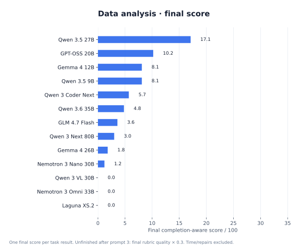
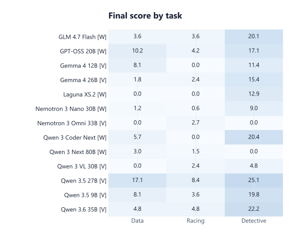
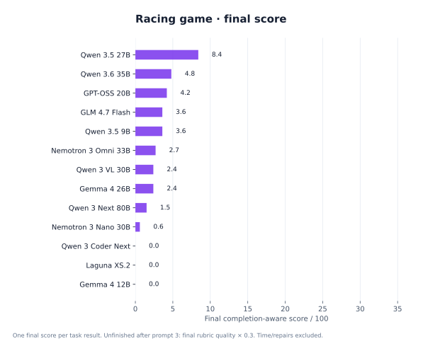
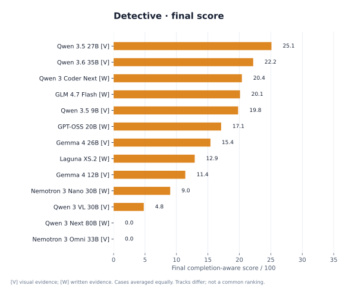
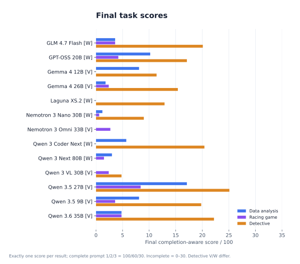
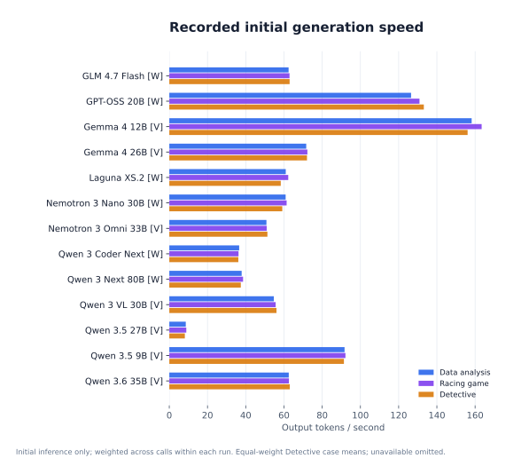
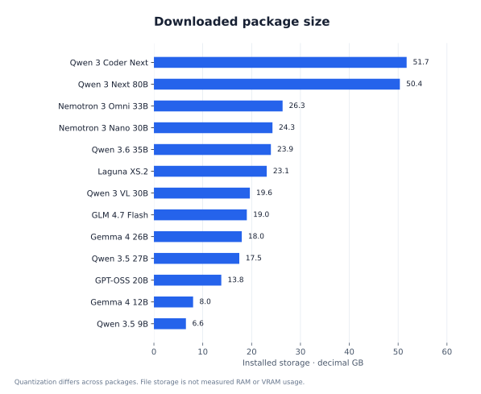
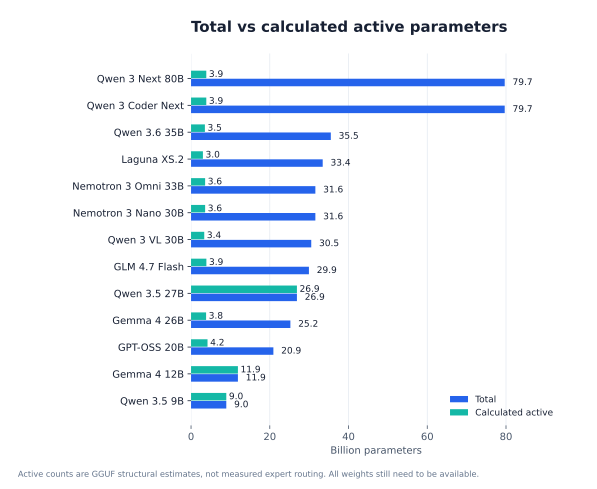
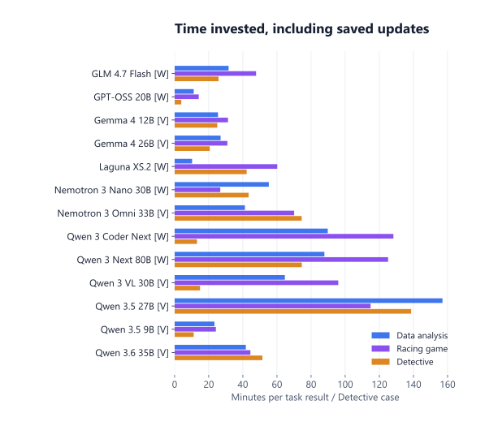

# Local AI Benchmark

**What can local AI models actually finish on a powerful desktop?** Explore 13 installed models across data analysis, a 3D racing game and evidence-based detective investigations. Compare their saved outputs, output-only rubric judgments, token speed and memory-related model sizes in an interactive dashboard.

[**Explore the dashboard →**](https://maninka123.github.io/local-ai-benchmark/) · [Results guide](docs/publication/RESULTS.md) · [Methodology](docs/publication/METHODOLOGY.md) · [Run on your PC](docs/publication/RUN_ON_YOUR_PC.md)

| Models | Task families | Saved task results | Output reviews | Desktop |
| :-- | :-- | :-- | :-- | :-- |
| **13** | **3** | **53** | **159**, across three prompts | **RTX 4080 16 GB · i9-13900K · 64 GB RAM** |

This repository publishes the benchmark software, compact measurements, task prompts, review evidence and saved outputs. **Model weights are not included.** The public dashboard lets you explore results and open available reports and game builds without installing an AI model. Local reruns and further prompting require your own Ollama installation and model downloads.

## Read the results correctly

**Only 1 of 53 task results met the full completion requirements:** Qwen 3.5 27B, Detective case 3, on its third benchmark prompt. Many other outputs demonstrate useful partial work, but an opening page or an executable script does not mean the full challenge was completed.

Each task result has **exactly one final score**. Fully completed on prompt 1: **100**; prompt 2: **60**; prompt 3: **30**. If still incomplete after prompt 3, the final output's rubric quality determines **0–30 partial credit**. Earlier failed attempts show their status and review notes, without an awarded score.

These are **AI rubric judgments, not human ratings**. Time, token speed and separately assisted repairs do not influence the score. Original automatic results remain separate and preserved. Visual and written Detective tracks supply different evidence and have different case coverage; their case averages are labelled and should not be treated as one common ranking. The AI review uses the same category weights for both tracks; preserved automatic rubrics remain separate.

## Results at a glance

Compact figures are generated from the [published chart data](docs/publication/chart-data.json). Open the dashboard to change task, chart axes, metric, model selection and initial/latest result scope, or inspect exact values and rubric reasons.

| Data analysis final scores | Final scores by task |
| :--: | :--: |
|  |  |
| **Data analysis:** useful findings are different from a correct, reproducible investigation. | **Final scores:** one awarded score per task result; earlier failures retain notes. |

| Racing game | Detective investigations |
| :--: | :--: |
|  |  |
| **Gameplay:** a compiled page can still lack driving, opponents, checkpoints or a complete race. | **Evidence:** [V] = visual exhibits; [W] = written evidence. Cases averaged equally. |

| Completion-aware review scores | Recorded token speed |
| :--: | :--: |
|  |  |
| **Scores:** incomplete work stays within the 0–30 partial-credit band. | **Throughput:** recorded initial generation tokens/s, kept independent of quality. |

<strong>More comparisons: storage, active parameters, total time and capacity</strong>

| Installed model storage | Total vs calculated active parameters |
| :--: | :--: |
|  |  |
| Decimal GB of downloaded packages; quantization differs. | Structural estimates from installed GGUF tensors; not measured routing. |

| Total time invested | Capacity and output quality |
| :--: | :--: |
|  |  |
| Initial work + saved updates + re-evaluations. Detective shown per case. | A larger package does not guarantee a more complete output. |

All charts omit unavailable measurements rather than inventing zeros. This is a single-PC, predominantly single-run capability study, with mixed model quantization, historical task budgets and distinct Detective tracks. It is not a universal intelligence leaderboard. See [measurement definitions and limitations](docs/publication/METHODOLOGY.md).

## Three challenges, actual outputs

| Challenge | What the model must deliver | What you can inspect |
| :-- | :-- | :-- |
| **Data analysis** | Investigate six related tables, identify unexpected patterns, produce executable analysis, findings, charts and a written report. | Initial and updated reports, figures, source, numerical findings and category-level review reasons. |
| **3D racing game** | Build a complete playable race, including cars, opponents, driving, cameras, collisions, checkpoints/laps and interface states. | Saved source and available game builds. Open playable previews in the dashboard or a browser tab. Partial builds are labelled. |
| **Detective** | Reconstruct fictional cases from evidence, reason about suspects and uncertainty, and avoid unsupported conclusions. | Case reports, evidence links, timelines and separate visual/written-track judgments. |

The dashboard separates **initial results**, **further model work**, **rubric reviews** and **frontier reference outputs**. Each original attempt stays available. Small independently assisted repairs are disclosed separately with their changed-line counts and do not improve a model's score.

## Tested desktop

| Component | Recorded configuration |
| :-- | :-- |
| GPU | NVIDIA GeForce RTX 4080, 16 GB VRAM |
| CPU | Intel Core i9-13900K, 32 logical processors |
| RAM | 64 GB installed; recorded usable memory ≈ 63.7 GiB |
| OS | Windows, build 26300 |
| Inference | Local Ollama; installed package identity and quantization retained |
| Candidate execution | Docker Linux containers, isolated per task: 6 GiB memory, 4 CPUs, no network |

The GPU runs inference; sandboxed game rendering is a separate workload and does not represent native RTX 4080 gaming performance. Large MoE models may need CPU/RAM offload even when their active parameter count is small.

## Models included

Qwen 3.5 9B · Gemma 4 12B · Qwen 3.5 27B · Gemma 4 26B A4B · GLM 4.7 Flash · Qwen 3.6 35B A3B · Nemotron 3 Nano 30B · Nemotron 3 Nano Omni · Laguna XS.2 · GPT-OSS 20B · Qwen 3 Coder Next · Qwen 3 Next 80B A3B Thinking · Qwen 3 VL 30B A3B Instruct.

Display names are shortened for readability. Exact installed IDs, measured package sizes and structural parameter estimates are included in the dashboard and [chart data](docs/publication/chart-data.json). DeepSeek-OCR is outside this benchmark.

## Explore first, reproduce later

- [**Public dashboard**](https://maninka123.github.io/local-ai-benchmark/): browse plots, scores, prompts and saved outputs. No model download required.
- [**Results guide**](docs/publication/RESULTS.md): understand attempts, completion, playable builds and separately assisted repairs.
- [**Reproduction guide**](docs/publication/RUN_ON_YOUR_PC.md): install the controller, choose your own models and run fresh tasks locally.
- [**Methodology**](docs/publication/METHODOLOGY.md): scoring formula, task rubrics, input tracks, measurement definitions and limitations.

Want help choosing a model that fits your hardware before running a benchmark? See [**local-llm-fit**](https://github.com/maninka123/local-llm-fit), a separate project for exploring model fit on your own PC. Fit estimates and this benchmark's output-quality scores answer different questions.

## What this experiment shows

- **Local models can produce useful partial work:** code, charts, reports and investigations are worth inspecting, even when the entire challenge remains unfinished. The [task score gallery](docs/assets/quality-progress.svg) distinguishes their strengths.
- **Presentation can hide missing substance:** a polished report can contain incorrect conclusions; a compiled game can still lack driving or a complete race. Read the rubric evidence alongside the output.
- **Completion is the harder standard:** only **1/53** local results was fully complete after up to three benchmark prompts. The [final scores](docs/assets/review-scores.svg) preserve partial credit without presenting unfinished work as success.
- **Speed and size are different from quality:** compare [generation speed](docs/assets/token-speed.svg), [storage](docs/assets/model-storage.svg) and [task scores](docs/assets/quality-vs-storage.svg). Larger packages and faster responses did not guarantee more complete work in this desktop study.
- **Frontier references show a richer target output:** GPT-6 Astra's three consolidated examples include analysis and investigation reports plus a racing game with verified keyboard gameplay and completed laps. Their tools and execution environment differ, so there is **no directly comparable local quality or speed score**. Open them in the dashboard to compare the deliverables, not claim a controlled model ranking.

Created and maintained by **[Pasindu · @maninka123](https://github.com/maninka123)**. Model names belong to their respective publishers; this is an independent benchmark project.
