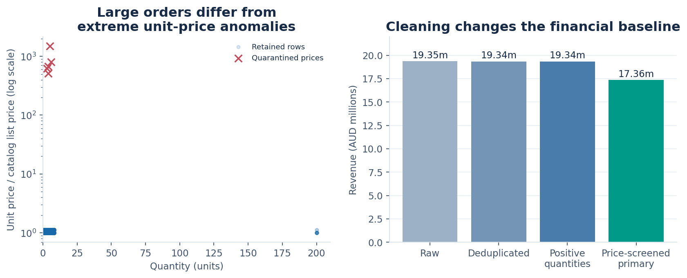
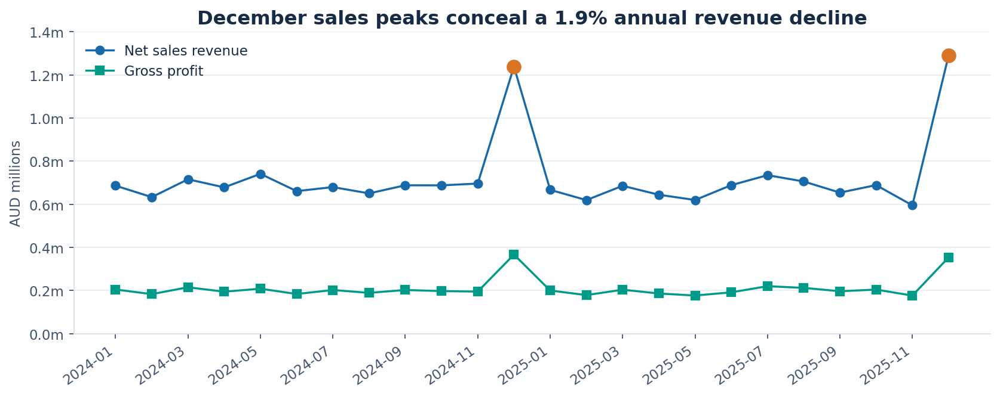
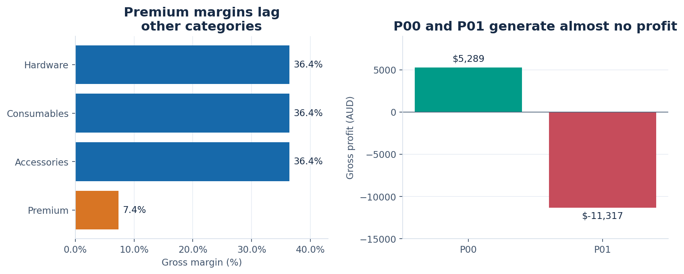
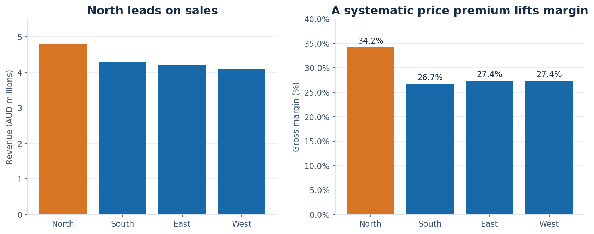
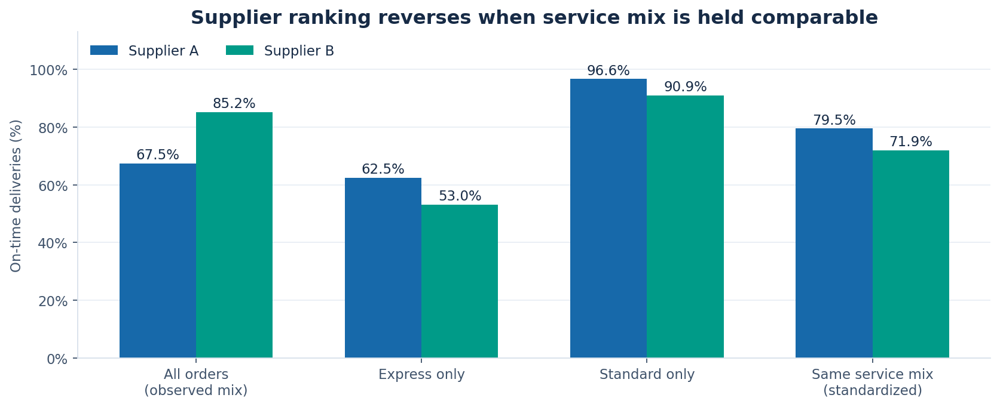
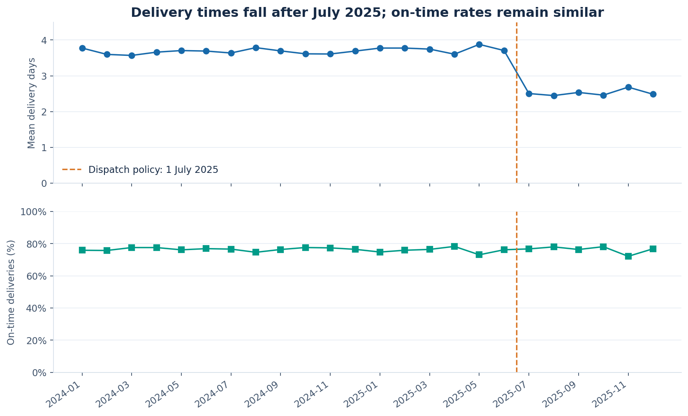
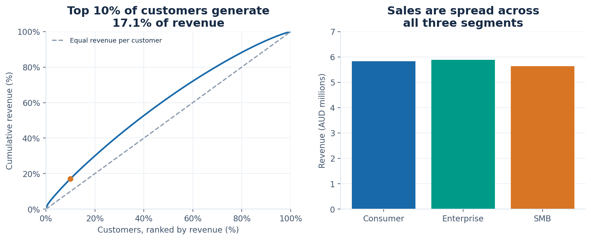
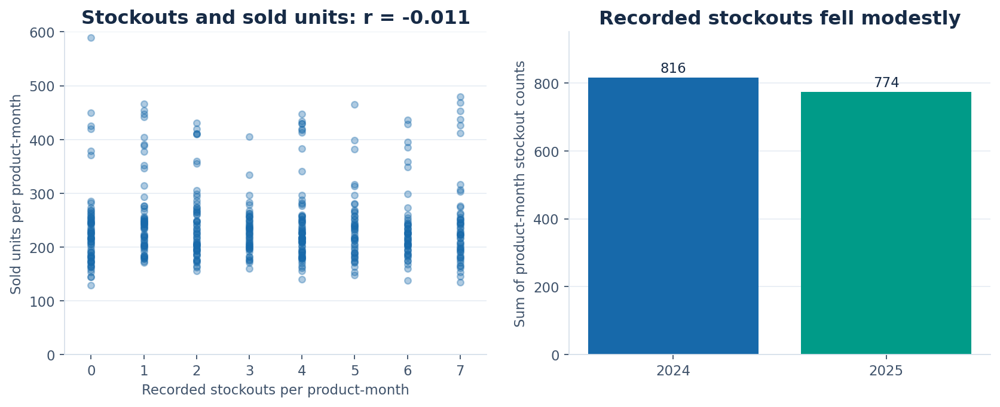

# Aurora Instruments | Performance investigation

2024–2025 · AUD · Management reference report

## Executive summary

Aurora generated **AUD17.36 million revenue and AUD5.05 million gross profit**, a **29.09% gross margin**, across 24,963 retained completed sales. Revenue declined 1.86% in 2025 despite conspicuous December peaks. The priority is profitable growth: products P00 and P01 generated 20.03% of revenue but together lost AUD6,028 before overheads. Supplier rankings also need correction for service mix: supplier B looks better overall, while A performs better within both express and standard deliveries.

Average delivery time fell after the July 2025 dispatch event, but recorded on-time performance barely changed. This supports investigation of both operational improvement and measurement definitions, rather than a causal success claim. Five implausible prices account for AUD1.985 million of the uncleaned financial total; their exclusion is a disclosed analytical decision requiring invoice confirmation. All results describe the supplied fictional records, not audited financial statements.

## Dataset overview

Every supplied dataset and the data dictionary were examined. Transactions cover every calendar date from 1 January 2024 through 31 December 2025; date coverage alone cannot establish extraction completeness. There are 1,200 customers, 20 products and four regions. All customer joining dates precede this sales window, so acquisition and new-customer growth cannot be evaluated here.

| Dataset | Raw rows | Grain and purpose |
| --- | ---: | --- |
| transactions.csv | 25,000 | Completed sale; transaction_id is the business key |
| products.csv | 20 | Product; category, list price and standard cost |
| customers.csv | 1,200 | Customer; segment, home region and joining date |
| regions.csv | 4 | Region; name, timezone and shipping distance |
| inventory.csv | 480 | Product × month; stock units and stockout counts |
| operational_events.csv | 3 | Dated event; regional or company-wide scope |

Identifier and categorical fields are strings; quantities, flags and inventory measures are integers; prices, revenue, delivery days and advertising index are numeric. Date strings were parsed and validated. Customer, product and region joins are many-to-one; inventory joins only after aggregation to product-month. Every relevant foreign key matched, and joins preserved row counts. Customer home regions agree with transaction regions. The events table uses ALL for company-wide events, which is a scope marker rather than a missing region.

## Data quality assessment

Twenty exact duplicate transaction copies add AUD14,718.41 and are removed once; no conflicting retained business keys remain. Twelve records have quantity −2 and combined revenue −AUD3,301.28. The dictionary explicitly defines completed sales rather than returns, so these rows are quarantined rather than reinterpreted. No other nonpositive quantities occur.

Five records have unit price AUD99,000, or 513–1,500 times their product list prices. All other positive-quantity prices are approximately 1.00 or 1.12 times list. A conservative rule quarantines prices above ten times list: this isolates a clear gap without asserting the true replacement value. These five rows total AUD1,984,950. Keeping them after deduplication and quantity cleaning would produce AUD19,340,397.83 revenue, versus the primary AUD17,355,447.83. This sensitivity is material; finance should resolve the invoices before adopting a statutory total.

Thirty transaction costs are missing. Every observed transaction unit cost equals its product’s catalog cost, supporting a transparent catalog fill for these rows. The filled cost is AUD17,438 on AUD24,128.83 revenue. Omitting those rows instead gives 29.0875% margin, compared with 29.0856% after filling: the aggregate conclusion is insensitive, although actual historical costs remain unverified.

Ten 200-unit orders are retained because prices and revenue arithmetic are consistent with normal transactions. They contribute AUD345,980.40, or 1.99% of revenue; unusual size alone is insufficient grounds for deletion. No missing values occur outside transaction cost. Dimension and inventory keys are unique; date parsing, numeric ranges, foreign keys and revenue identities pass. Stored revenue differs from quantity × price × (1 − discount) by at most half a cent, consistent with currency rounding.

## Analytical methodology

Revenue uses the recorded discounted amount after eligibility screening. Gross profit subtracts quantity × effective unit cost; margin is total gross profit divided by total revenue, never an unweighted average of row margins. It excludes freight, marketing, overhead and tax. Delivery rates use retained transaction counts, not revenue weights. Missing values are not treated as zero.

Monthly and annual aggregations investigate time; product, region and customer joins support segment comparisons. Supplier comparisons are stratified by service and standardized to the combined observed service mix. Dispatch comparisons use the stated 1 July 2025 boundary, with a same-year half-year sensitivity. Inventory and sales are matched at product-month grain. Correlations are descriptive Pearson coefficients, without causal interpretation or significance claims. An independent standard-library Decimal implementation rereads the original CSVs and checks financial totals and subgroup numerators separately from pandas.

## Main findings

### 1. December peaks do not establish sustained growth

**Calculated evidence.** Revenue declined from AUD8,759,322.61 in 2024 to AUD8,596,125.22 in 2025; gross profit fell 1.68%, from AUD2,545,357.61 to AUD2,502,578.22. Transactions fell 1.25% and units 1.46%. December revenue was AUD1,238,795.61 and AUD1,290,220.47, respectively: 81.2% and 94.3% above each year’s January–November monthly average.

**Method and significance.** Complete calendar-year totals and within-year monthly baselines distinguish broad performance from seasonal peaks. December transaction counts of 1,784 and 1,805 also exceed January–November averages of 980 and 963. Capacity planning should anticipate the peak while commercial planning addresses flat-to-declining annual sales.

**Limitation.** Only two years are available. The December 2024 campaign event coincides with a peak, but December 2025 peaks too without a recorded campaign event. Seasonality, repeat promotion and other factors cannot be disentangled. Excluding the ten large orders still leaves a 2.07% annual revenue decline.

### 2. Two high-revenue products consume the profit opportunity

**Calculated evidence.** Premium’s margin is 7.37%, versus 36.41–36.45% for the other categories. Within Premium, P00 earns only AUD5,289.45 on AUD1,680,219.45 sales; P01 loses AUD11,317.40 on AUD1,796,602.60 sales. Together they account for 2,442 transactions, 20.03% of revenue and negative AUD6,027.95 gross profit. All 1,519 negative-profit transactions involve these two products.

**Method and significance.** Product-level revenue and extended-cost sums reveal that the category label hides substantial variation: P02–P04 remain profitable. At their AUD325 list price and AUD310 cost, P00/P01 break even at only a 4.62% discount before other expenses. Discount governance and supplier-cost negotiations should focus here first.

**Limitation.** North uses higher prices, so the list-price discount threshold is not universal. These calculations do not measure cross-selling, customer lifetime value or strategic reasons for a loss-leading product.

### 3. North’s advantage is closely associated with pricing

**Calculated evidence.** North earns AUD4,781,853.42 revenue and a 34.18% margin; South, East and West earn margins of 26.72%, 27.36% and 27.37%. North’s price-to-list ratio averages almost exactly 1.12, while every retained non-North price equals list. Mean discounts are similar: 7.39% in North versus 7.50% elsewhere.

**Method and significance.** Comparing transaction prices with matched catalog prices uncovers a systematic regional premium. A fixed-volume arithmetic scenario dividing North revenue by 1.12 reduces its margin to 26.28%, illustrating the premium’s accounting importance. Regional margin targets should acknowledge price realization before attributing differences to operating efficiency.

**Limitation.** The scenario is not a forecast: changing prices could change demand, mix or discounting. Regional distance is a single static attribute per region; four regions cannot support a credible causal estimate of shipping-distance effects.

### 4. Supplier rankings reverse after controlling service mix

**Observed association.** B’s aggregate on-time rate is 85.22%, compared with A’s 67.45%. Yet A leads within express, 62.46% versus 53.04%, and within standard, 96.65% versus 90.91%. A handles 10,643 express and 1,819 standard transactions; B handles 1,878 express and 10,623 standard transactions.

**Method and significance.** Express represents 85.40% of A’s work and only 15.02% of B’s. Standardizing both suppliers to the combined 50.16% express share yields 79.50% for A and 71.91% for B. This is an aggregate-versus-subgroup reversal, not evidence that B is intrinsically superior. Procurement scorecards should show both workload mix and within-service outcomes.

**Limitation.** Service labels may imply different promises or harder assignments; route, urgency and selection remain uncontrolled. Standardization corrects one measured mix difference, not all confounding. Supplier reassignment effects cannot be estimated from these summaries.

### 5. Faster deliveries do not translate into a clear on-time improvement

**Observed association.** Before July 2025, 18,281 transactions average 3.694 delivery days; the following 6,682 average 2.512, a 1.182-day reduction. On-time rates are nearly unchanged at 76.31% and 76.46%. Comparing only 2025 gives 3.747 versus 2.512 days and 75.77% versus 76.46% on time.

**Method and significance.** Monthly plots and event-boundary comparisons show that delivery time declines in all four regions and both service classes. Express averages fall from 4.463 to 3.253 days; standard from 2.916 to 1.780. The timing is consistent with the dispatch-policy event and merits operational follow-up.

**Limitation.** There is no untreated control group, promised-delivery date or documented on-time threshold. A policy effect is a hypothesis. Faster transit with a stable flag may reflect different service promises or measurement behavior. The East brand-refresh event explicitly states no logistics changes and should not be credited with the company-wide reduction.

### 6. Revenue concentration is modest, but customer profitability differs

**Calculated evidence.** All 1,200 customers transact. The largest customer contributes 0.45% of revenue; the top ten contribute 2.92%, and the top 120 contribute 17.08%. Enterprise, Consumer and SMB revenues are AUD5.887 million, AUD5.834 million and AUD5.634 million, with margins of 28.84%, 29.15% and 29.27%.

**Method and significance.** Customer totals sorted by revenue and segment aggregates show broad participation. However, customer C0501 generates AUD76,157.19 sales and negative AUD1,270.81 gross profit, heavily influenced by its 200-unit P01 order. Retention priorities should consider profit as well as sales rank.

**Limitation.** These are observed purchasing customers, with no leads, inactive account histories or lifetime servicing costs. Arbitrary marketing-group codes do not establish exposure to a controlled campaign.

### 7. Inventory and advertising fields do not establish demand drivers

**Calculated evidence and associations.** The 480 product-month records contain 1,590 stockouts; 408 report at least one. Annual counts decline from 816 to 774. Product-month sold units and stockouts have correlation −0.0107; stock units and stockouts have correlation −0.0228. At transaction grain, advertising index and revenue have correlation −0.00665.

**Method and significance.** Aggregating sales before the inventory join prevents repeating stockouts once per transaction. Scatter plots and simple correlations show no strong linear relationship in these measurements. They do not support a quantified stockout-loss estimate or an advertising-return claim.

**Limitation.** Stock timing, replenishment, unmet demand, campaign spend and exposure definitions are absent. Stockouts may suppress observed sales, and product-month aggregation can hide short disruptions. Near-zero correlation is not evidence of no business effect.

## Interpretation and limitations

The dataset supports descriptive comparisons and accounting decompositions. It does not support causal policy attribution, audited net profit, inventory turnover or marketing ROI. Unknown extraction completeness, catalog-cost imputation and unresolved extreme prices remain consequential qualifications. Temporal comparisons use transaction date, not dispatch date; event exposure may therefore be imperfect. Deterministic relationships and balanced master tables also reflect the fictional nature of the source and should not be generalized to real operations.

## Operational recommendations

First, finance should resolve the five price anomalies and twelve invalid quantities against source documents, then enforce unique transaction keys, positive sale quantities and required costs. Second, commercial owners should review P00/P01 discount floors and cost terms, testing demand responses before broad repricing. Third, procurement should adopt service-stratified supplier scorecards and track route and promised-date information before changing allocations. Fourth, operations should reconcile on-time definitions with delivery duration and validate the dispatch change using time-aligned orders and appropriate comparison groups. Finally, planning should prepare for December volume while collecting inventory availability and unmet-demand histories. These are recommendations, not measured savings commitments.

## Conclusion

Aurora’s main management opportunity is to protect margin while improving the quality of commercial and operational decisions. The verified records show slightly declining annual sales, a specific premium-product profit leak, a regional price effect and a misleading aggregate supplier comparison. Resolving the financial exceptions and measurement gaps will make those decisions more reliable.

## Reproducibility and evidence

All figures use the supplied data and retained analytical population. Run analysis.py, then build_report.py and verify.py from this output folder with Python and the recorded dependencies. The default data location is the original benchmark datasets/data_analysis directory; analysis.py and verify.py accept --data-dir. Source SHA-256 hashes, field profiles, quarantined rows, filled-cost rows, aggregate tables and structured findings are retained alongside this report. The standalone HTML embeds every chart and uses no external assets. Independent checks and their limits are recorded in the parent verification.json. This is a tool-assisted authored reference, not ground truth or a comparable timed local-model benchmark.
